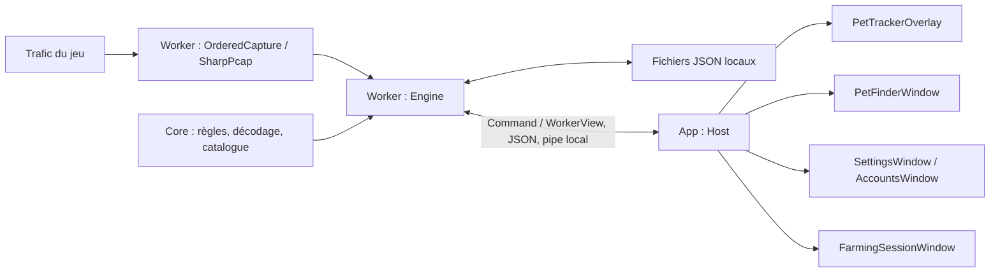

# PetTracker Aion — analyse technique et proposition de refonte

Analyse du 2 novembre 2026, sur le commit local `a04093f` (version déclarée :
`0.1.59`). Le périmètre de cette étape est l'analyse du code existant et la
préparation de la refonte. Aucun comportement de l'application n'est modifié.

## Conclusion

Une refonte complète de l'expérience utilisateur est réalisable en conservant
le moteur de capture et les règles de progression. La séparation entre capture
et interface existe déjà : deux processus communiquent par un canal local.
La séparation entre présentation, orchestration et fenêtres reste en revanche
partielle dans le client Windows.

**Recommandation technique : conserver WPF, adopter progressivement une
présentation MVVM et réorganiser les écrans.** Cette approche permet l'option B
du cahier des charges sans imposer un changement de framework ni une réécriture
du protocole du jeu. Il s'agit d'une recommandation, pas d'un choix artistique
définitif. La proposition visuelle est détaillée dans
[DIRECTION-ARTISTIQUE.md](DIRECTION-ARTISTIQUE.md).

## État du dépôt

- Le code source est déjà présent dans ce dossier ; un nouveau clonage n'est
  pas nécessaire pour commencer.
- `origin` pointe vers `git@github.com:JSFougere/PetTrackerAion.git`.
- Aucun remote `upstream` n'est configuré. Le dépôt d'origine indiqué dans le
  cahier des charges est [0Fox2Give/PetTracker](https://github.com/0Fox2Give/PetTracker).
- Le lien de parenté « fork » enregistré par GitHub n'a pas été vérifié ; un
  remote Git ne suffit pas à le prouver.
- Le répertoire de travail ne contenait aucune modification suivie avant
  cette analyse.
- Le README, les liens de téléchargement et `publisher.json` portent encore
  l'identité et les destinations du projet d'origine.

## Organisation technique observée

| Composant | Technologie et rôle | Position dans la refonte |
| --- | --- | --- |
| `src/App` | Client Windows WPF, `net10.0-windows`, intégration Windows Forms pour les fonctions système | Zone principale de modification |
| `src/Core` | Bibliothèque `net10.0` : progression, catalogue, filtres, contrats, stockage et décodage | Conserver les règles et formats existants |
| `src/Worker` | Exécutable de capture ; SharpPcap `6.3.1`, PacketDotNet `1.4.8`, moteur `Engine` | Conserver la capture et le traitement |
| `src/Updates` | Velopack `1.2.161`, flux signés, validation des paquets et cycle de mise à jour | Isoler l'identité du fork avant distribution |
| `src/Setup` | Installateur hors ligne WPF et désinstallation | Adapter les destinations et l'identité |
| `src/Linux` | Client expérimental Avalonia `12.1.4` partageant Core et Worker | Hors périmètre visuel Windows ; préserver Core |
| `tests` | Exécutables de vérification du moteur, de WPF, des mises à jour et autres contrôles spécialisés | Réutiliser comme référence de non-régression |
| `assets` | Catalogue, portraits, cristaux et cartes | Conserver les attributions et vérifier les droits séparément |

Ces versions proviennent des fichiers du dépôt ; elles ne constituent pas une
recommandation de mise à niveau. `global.json` fixe le SDK à `10.0.401`, avec
acceptation des correctifs compatibles. `Directory.Build.props` fixe le runtime
à `10.0.12`. Npcap est une dépendance externe de la capture Windows et n'est pas
embarqué dans l'application.

### Circulation actuelle des données



`WorkerContracts.cs` expose `Command` et `WorkerView`. Le client vérifie la
version de protocole `3`. `Host.Send` sérialise les commandes, utilise un pipe
nommé réservé à l'utilisateur courant et attend la réponse du worker. Le
worker applique les commandes à `Engine`, qui gère les données et leur
persistance. `Host` lance le processus de capture si nécessaire.

Le client interroge normalement le statut chaque seconde avec un
`DispatcherTimer`. Une cadence de 250 ms existe pour la navigation expérimentale,
mais celle-ci est désactivée par la normalisation des paramètres. La refonte ne
doit pas activer cette fonction par effet de bord.

### Fichiers responsables de l'interface

| Fichier dans `src/App` | Responsabilité |
| --- | --- |
| `Program.cs` | Démarrage, zone de notification, commandes globales, prévisualisation `--render` |
| `Host.cs` | Communication avec le worker, état courant, ouverture des fenêtres, notifications, visibilité et mises à jour |
| `PetTrackerOverlay.cs` | Fenêtre transparente au premier plan, activité récente, proximité, épingles et marchand |
| `PetFinderWindow.cs` | Recherche, filtres enregistrés, liste de familiers, détails, objectifs et onglet carte |
| `SettingsWindow.cs` | Paramètres, enregistrement différé, diagnostic de capture et mises à jour |
| `AccountsWindow.cs` | Gestion des profils et comptes |
| `FarmingSessionWindow.cs` | Bilan des gains de la session |
| `FarmingMapView.cs`, `FarmingMapCanvas.cs` | Présentation et interactions des cartes |
| `CollectionOverview.cs`, `PetFamilyBadge.cs` | Composants de collection et badges |
| `Theme.cs` | Thème, règles d'apparence de l'overlay, placement multi-écran et comportements Windows |
| `NativeTheme.xaml`, `FinderStyles.xaml` | Ressources, styles et modèles de contrôles |

La majorité des écrans est construite directement en C#. Les fichiers XAML
existants sont surtout des dictionnaires de styles : il ne s'agit pas d'une
application déjà organisée en vues XAML avec un ViewModel par écran.
`PetFinderWindow.SearchRow` utilise déjà `INotifyPropertyChanged`, ce qui offre
un point d'appui pour une évolution progressive.

### Couplages à réduire

1. Les fenêtres dépendent directement de `Host`, lisent son état et exécutent
   ses commandes. `Host.Accept` actualise lui-même certaines fenêtres et
   crée ou masque l'overlay.
2. `Host` mélange transport, lancement du worker, état de présentation,
   navigation, notifications et cycle de mise à jour.
3. `Theme.cs` associe thème visuel, politique d'expiration des lignes,
   positionnement des fenêtres et appels natifs Windows.
4. Plusieurs couleurs et dimensions sont définies dans les constructeurs C#,
   en complément des ressources XAML. Modifier un dictionnaire seul ne suffit
   donc pas à appliquer un thème cohérent partout.
5. Les tests WPF connaissent certains détails des contrôles actuels. Les
   assertions de comportement doivent être conservées pendant leur adaptation
   à la nouvelle structure des vues.

Le moteur n'est donc pas à extraire de zéro. La priorité architecturale est de
créer une frontière de présentation claire dans le client Windows.

## Architecture cible proposée

Conserver les projets Core, Worker, Updates et Setup. Dans un premier temps,
réorganiser `src/App` par responsabilités, sans multiplier les projets ni ajouter
un framework d'interface supplémentaire.

```text
src/App/
  Services/
    WorkerClient.cs          # Command/WorkerView, pipe, connexion et lancement
    TrackerSession.cs        # État présenté, interrogation, commandes sérialisées
    WindowService.cs         # Ouverture des fenêtres et navigation
    OverlayWindowService.cs  # Visibilité, placement, verrouillage, clics traversants
  ViewModels/
    OverlayViewModel.cs
    CollectionViewModel.cs
    PetDetailsViewModel.cs
    SettingsViewModel.cs
    AccountsViewModel.cs
    FarmingSessionViewModel.cs
  Views/                     # Vues XAML et code lié aux interactions visuelles
  Controls/                  # Ligne de familier, badge, progression, état de connexion
  Themes/                    # Couleurs, espacements, typographie et styles
```

Cette arborescence est une cible, pas une structure déjà créée. Extraire d'abord
`WorkerClient` et un contrat testable `IWorkerClient`. Maintenir ensuite `Host`
comme adaptateur de transition pour éviter de migrer tous les écrans à la fois.

Le service de session publiera l'état reçu, et les ViewModels transformeront cet
état en propriétés affichables et commandes. Les vues conserveront uniquement
les interactions visuelles. Les calculs de rangs, d'âmes, de proximité, de
marchand et d'objectifs resteront dans Core. Les modèles reçus ne devront pas
être modifiés directement par les vues : passer par les commandes existantes.

Les appels Windows, le polling et les fenêtres resteront dans App, sans ajouter
de dépendance WPF à Core. Conserver la sérialisation des requêtes, les délais
d'attente, la reconnexion et l'arrêt coordonné du worker. Appliquer les changements
de propriétés sur le thread de l'interface et libérer les abonnements à la
fermeture des vues. Un changement de personnage doit invalider les détails et
actions associés au personnage précédent.

Une nouvelle dépendance MVVM n'est pas nécessaire à cette étape : les contrats
peuvent reposer sur `INotifyPropertyChanged` et `ICommand`.

## Fonctionnalités et données à préserver

| Fonction | Points d'appui existants | Critère de conservation |
| --- | --- | --- |
| Capture et synchronisation | Worker, Engine, GameProtocol, CollectionWire | Même reconnaissance de collection ; reprise après interruption |
| Rangs et âmes | PetCollection, PetStages, Tracking | Aucun calcul réimplémenté dans une vue ; valeurs inconnues conservées |
| Recherche et filtres | PetFinder, FinderPreset, AppSettings | Même résultat pour une requête et un profil donnés |
| Proximité | Nearby, Activity | Observations récentes clairement datées, sans distance inventée |
| Épingles | PetPins, AppSettings | Limite, ordre et persistance identiques |
| Marchand | BlackMarket, MerchantDisplay | Stock observé et progression conservés, états absents explicites |
| Objectifs, session et cartes | FarmingSession, FarmingGoals, FarmingAtlas | Commandes, gains, filtres partagés et limites des cartes conservés |
| Profils, sauvegardes et reprise | Storage, LocalProfileBinding, AutomaticRecovery | Pas d'écrasement de collection ni d'association à un autre personnage |
| Paramètres | SettingsPatch, AppSettings.Normalize | Compatibilité des JSON et gestion des échecs d'enregistrement |
| Overlay | OverlayGeometry, WindowBehavior, raccourcis et zone de notification | Premier plan, DPI, écrans multiples, verrouillage et clics traversants fonctionnels |

Le répertoire de données par défaut est `%LOCALAPPDATA%\PetTracker`. Il contient
notamment `settings.json`, `profiles.json`, les profils sous `profiles/`, et des
sauvegardes et diagnostics. `Storage.Save` écrit via un fichier temporaire et
conserve un `.bak` lors du remplacement. La récupération gère aussi des
sauvegardes validées ; une importation doit préserver ces garanties.

La refonte doit distinguer valeur inconnue et zéro, données sauvegardées et
collection confirmée en direct. Une connexion active au worker ne prouve pas
à elle seule que la collection du personnage est synchronisée.

## Isolation du fork et mises à jour

Une compilation simple avec `Build.ps1` n'embarque pas `publisher.json` : les
mises à jour automatiques ne sont pas disponibles dans cette édition. C'est
un point de départ adapté à un prototype distribué manuellement. En revanche,
passer `-UpdatePublisherFile ./publisher.json` embarquerait la configuration du
projet d'origine actuellement présente dans le dépôt.

Avant toute distribution indépendante, prévoir les adaptations suivantes :

| Élément | Situation actuelle | Cible proposée |
| --- | --- | --- |
| Flux et clé publique | Dépôt 0Fox2Give et clé publique d'origine | Flux du fork et sa propre paire de clés pour des mises à jour autonomes |
| Identifiant Velopack | `PetTracker.Desktop`, codé dans le validateur et le packaging | Identifiant propre, cohérent dans application, outils, scripts et tests |
| Installation hors ligne | `%LOCALAPPDATA%\Programs\PetTracker` | Destination distincte pour la version personnalisée |
| Données | `%LOCALAPPDATA%\PetTracker` | Dossier distinct, par exemple `%LOCALAPPDATA%\PetTrackerAion` |
| Instance unique | Mutex de session Windows indépendant du dossier de données | Identité du fork si coexistence avec l'original souhaitée |
| Processus et installation | Noms d'exécutables partagés ; Setup recherche les processus par nom | Éviter d'arrêter ou de remplacer l'installation d'origine |
| Raccourcis et registre | Noms et clé de désinstallation PetTracker | Noms et clés propres au fork |
| Documentation et workflows | Liens et conventions de l'amont | Liens du fork et publication indépendante |

Changer uniquement l'URL du flux ne réalise pas toute cette isolation.
Conserver les vérifications de signature, de taille, de hachage et l'arrêt du
worker avant application d'une mise à jour. La clé privée du fork ne devra
jamais figurer dans le dépôt ou dans les exécutables.

Un dépôt GitHub privé ne rend pas ses fichiers de release accessibles au client
actuel, qui n'a pas de mécanisme d'authentification à ce dépôt. Pour le premier
usage entre amis, privilégier la remise manuelle d'un paquet et de ses sources.
Si des mises à jour privées deviennent nécessaires, choisir un hébergement et
une méthode d'accès adaptés sans embarquer de jeton personnel partagé.

Pour reprendre une installation existante : arrêter l'application, sauvegarder
le dossier de données, puis importer ou copier vers le dossier distinct du
fork. Préserver l'original. `--data` permet l'isolation des essais, mais ne
contourne pas le mutex global du client actuel : arrêter l'instance existante
avant un lancement de test normal.

## Plan de réalisation

1. **Référence de départ.** Conserver le commit de base, les résultats des
   suites et les captures de référence. Utiliser des données de test isolées.
2. **Maquette.** Décliner la proposition visuelle sur l'overlay et la collection,
   avec données fictives, états inconnus et contrôles clavier. Arrêter la direction
   graphique avant le développement complet des écrans.
3. **Frontière de présentation.** Extraire le client worker et l'état de session
   derrière `Host`, sans modifier le contrat de protocole ni les fichiers JSON.
4. **Première tranche.** Migrer la collection et les détails vers des vues et
   ViewModels, en réutilisant recherche, filtres, épingles, objectifs et cartes.
5. **Overlay et réglages.** Migrer l'overlay, puis les paramètres, les comptes
   et le bilan de session. Vérifier les modes de clic, le positionnement et les
   erreurs de sauvegarde.
6. **Distribution du fork.** Isoler l'installation et les données ; produire un
   paquet Windows avec les sources correspondantes et les notices. Ajouter
   ensuite un canal autonome de mise à jour si nécessaire.

Ne pas conditionner la refonte à l'ajout de fonctions encore indéfinies. Garder
Linux compilable lors des changements de Core, sans engager une refonte de son
interface dans cette première phase Windows.

## Validation et limites

Le SDK attendu est installé. Les premières tentatives ont rencontré les limites
d'accès de l'environnement, puis une erreur de résolution de `api.nuget.org`
(`NU1301`). La restauration a ensuite réussi avec l'accès réseau autorisé,
dans un cache de dépendances sous `build/`.

Les résultats de compilation et des suites Windows sont consignés ci-dessous
après leur exécution. Les tests utilisent des dossiers sous `test-results/` et
ne lancent pas de capture du jeu. Ils ne démontrent pas la compatibilité en jeu.

| Vérification | Résultat observé |
| --- | --- |
| Compilation Release des projets de tests moteur, WPF et mises à jour, avec leurs dépendances | Réussie ; zéro avertissement et zéro erreur |
| Suite moteur `tests/Tests.csproj` | 869 vérifications réussies au total, incluant les 206 contrôles autonomes |
| Suite mises à jour `tests/UpdateTests/UpdateTests.csproj` | 61 vérifications réussies |
| Suite WPF dans l'environnement restreint | Arrêt au test de disponibilité des raccourcis Windows |
| Suite WPF avec accès au bureau autorisé | Passe le test des raccourcis, puis échoue sur l'assertion du prix marchand dans `tests/UiTests/Program.cs:645` |

L'assertion WPF attend le texte `80,000 Kina`, alors que le format numérique
`N0` de `PetFinderWindow.cs:639` dépend de la culture courante, ici `fr-FR`.
Cette dépendance au format anglais explique vraisemblablement l'échec ; elle
doit être confirmée par une exécution comparative en culture anglaise. La
suite WPF complète n'est donc pas validée. La correction de ce test et la
politique de formatage des nombres sont à prévoir avant la migration visuelle.

Les données de test et les captures WPF générées sont conservées localement
sous `test-results/initial-analysis-4782bf26dd4945688f7078b1948db6c2/`, notamment
dans `ui-desktop/`. Les captures `tracker-clean.png` et `finder-collection.png`
ont été inspectées pour confirmer l'organisation visuelle actuelle. Ce dossier
est ignoré par Git et ne fait pas partie des sources à distribuer.

Pour chaque tranche de refonte : exécuter les suites existantes pertinentes,
vérifier les captures WPF et compléter par les comportements réellement déplacés
(commandes, échecs, changement de profil). Pour l'acceptation finale, tester en
jeu la connexion, les gains, la proximité, l'alt-tab, les clics traversants,
plusieurs échelles DPI, la reconnexion et le redémarrage après sauvegarde.

Aucun paquet de distribution n'est produit à cette étape. L'installation,
l'importation de données réelles et le fonctionnement en jeu restent à vérifier.

## Références de l'analyse

Les constats techniques proviennent des fichiers cités ci-dessus, de
[BUILDING.md](BUILDING.md), de [MAINTAINING.md](MAINTAINING.md) et des scripts
de build. Le périmètre de licence indiqué par le dépôt est `GPL-3.0-only` dans
[NOTICE](../NOTICE) ; les ressources graphiques sont traitées séparément dans
[assets/README.md](../assets/README.md) et
[THIRD-PARTY-NOTICES.txt](../THIRD-PARTY-NOTICES.txt). Conserver ces documents
et les copyrights, ainsi que les sources correspondant à la version remise
aux utilisateurs, conformément au cadrage du projet.
